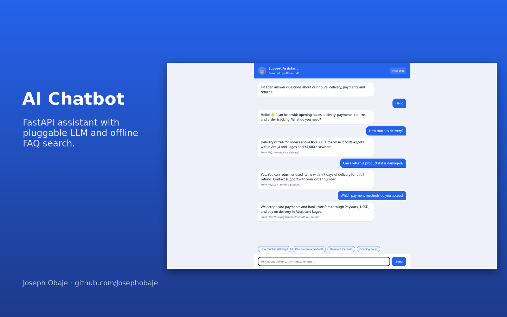
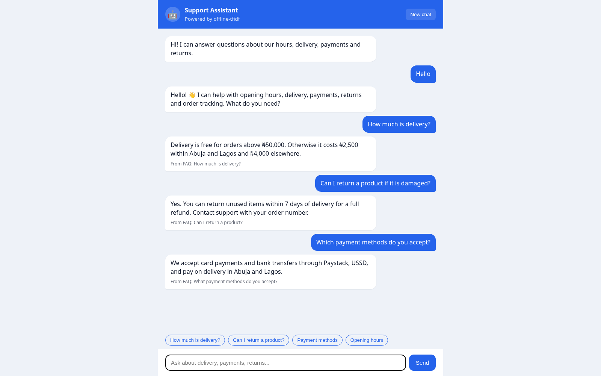
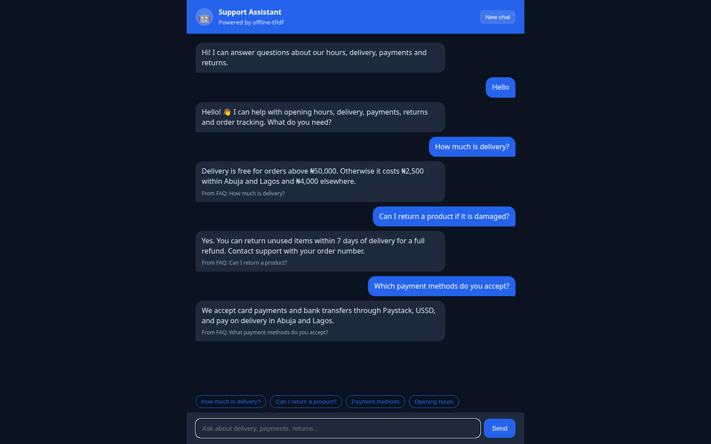
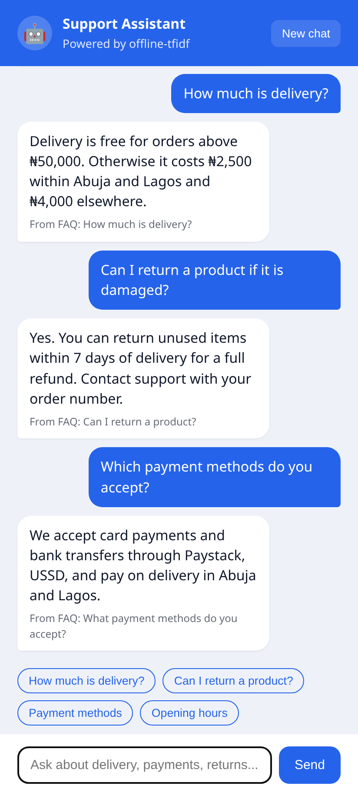

# AI Chatbot Assistant (FastAPI + Pluggable LLM + Offline FAQ Search)


A customer-support **AI chatbot** for businesses. It answers questions from **your own knowledge base** (Markdown FAQ files). Add an API key for any **OpenAI-compatible LLM** (OpenAI, Groq, OpenRouter, Ollama, LM Studio) and it writes natural answers grounded in the retrieved FAQ entries. With **no key it still works**, using a built-in dependency-free **TF-IDF retriever**. If the LLM call fails (quota, network), it falls back to the offline answer automatically.



| Desktop | Dark mode | Mobile |
| --- | --- | --- |
|  |  |  |

## Features

- **RAG-style answers**: top-3 FAQ matches are sent to the LLM as context with a strict "answer only from context" prompt
- **Pluggable providers** behind a small `Provider` protocol: `OfflineProvider` and `OpenAICompatibleProvider`
- **Works offline**: TF-IDF with stop words and light stemming, plus greetings and a polite "contact support" fallback
- **Chat history** per session (`session_id`), last 10 turns passed to the LLM, history and clear endpoints
- **Web chat UI** with quick-reply chips, source labels, dark mode and history restore after refresh
- **Custom knowledge base**: drop `.md` files with `## Question` headings into `knowledge/`
- **8 pytest tests**, with the LLM mocked through `httpx.MockTransport` (no network)

## Tech stack

Python 3.10+, FastAPI, Pydantic, httpx, Uvicorn, pytest, HTML/CSS/JS

## Getting started

```bash
git clone https://github.com/Josephobaje/ai-chatbot-assistant.git
cd ai-chatbot-assistant
python -m venv .venv && source .venv/bin/activate
pip install -r requirements.txt -r requirements-dev.txt
pytest                                  # 8 tests
uvicorn app.main:app --reload           # http://localhost:8000
```

To use an LLM, copy `.env.example` and export the variables (never commit real keys):

```bash
export LLM_API_KEY=your-key-here
export LLM_BASE_URL=https://api.openai.com/v1   # or https://api.groq.com/openai/v1, http://localhost:11434/v1 ...
export LLM_MODEL=gpt-4o-mini
```

## API

| Method | Path | Description |
| --- | --- | --- |
| POST | `/api/chat` | `{message, session_id?}` → `{reply, provider, sources, session_id}` |
| GET | `/api/history/{id}` | Conversation history |
| DELETE | `/api/history/{id}` | Clear a conversation |
| GET | `/api/health` | Provider and document count |

## Project structure

```text
app/
  main.py         # FastAPI app factory, sessions, endpoints
  providers.py    # Offline + OpenAI-compatible providers
  retrieval.py    # Markdown FAQ loader + TF-IDF retriever
  static/         # chat UI
knowledge/        # your FAQ markdown files
tests/
```

## Author

**Joseph Obaje**, Full Stack Developer (PHP, Python, Flutter) and Cybersecurity Specialist

- GitHub: [@Josephobaje](https://github.com/Josephobaje)
- LinkedIn: [joseph-obaje](https://www.linkedin.com/in/joseph-obaje)
- Email: [josephobaje264@gmail.com](mailto:josephobaje264@gmail.com)

## License

Released under the [MIT License](LICENSE). © 2026 Joseph Obaje
